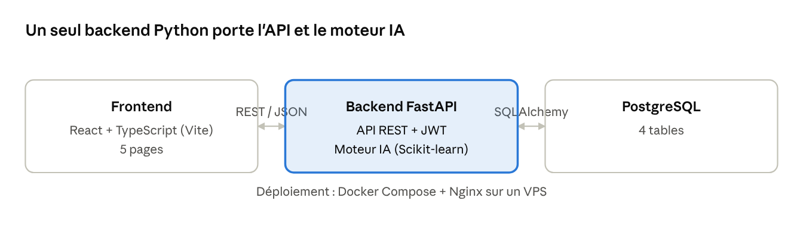
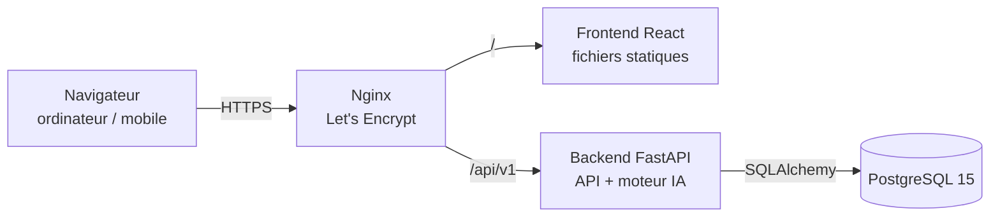

# Architecture

Architecture 3 couches. Un seul backend Python porte l'API REST et le moteur IA.





## Couches

| Couche | Technologie | Responsabilité |
|---|---|---|
| Frontend | React 18 + TypeScript + Vite | Pages publiques (dont l'essai sans compte, RF-12), apprenant et admin ; appels REST, stockage du JWT |
| Backend | Python 3.11, FastAPI, SQLAlchemy, Pydantic | Authentification, règles métier, API |
| Moteur IA | Scikit-learn (TF-IDF, cosinus) | Calcul du top 5 à chaque soumission |
| Données | PostgreSQL 15 | 4 tables, catalogue réel chargé par script SQL |
| Infra | Docker Compose, Nginx, Let's Encrypt | Un VPS, HTTPS |

Retirés pour le MVP : refresh token, Alembic (tables créées au démarrage), CI/CD.

## Pages frontend

| Page | Accès | Exigences |
|---|---|---|
| Connexion / Inscription | Public | RF-01, RF-02 |
| Catalogue (liste + filtres + détail) | Public | RF-05 |
| Questionnaire | Apprenant | RF-06, RF-07 |
| Mes recommandations | Apprenant | RF-08, RF-09, RF-10 |
| Administration (catalogue + chiffres clés) | Administrateur | RF-03, RF-04, RF-11 |

## Organisation du code proposée

```
backend/
├── app/
│   ├── main.py              # création de l'app, CORS, create_all, compte admin
│   ├── config.py            # variables d'environnement
│   ├── database.py          # engine, session SQLAlchemy
│   ├── models/              # Utilisateur, ProfilApprenant, Formation, Recommandation
│   ├── schemas/             # schémas Pydantic (entrées / sorties)
│   ├── routers/             # auth, users, formations, profil, recommandations, admin
│   ├── services/
│   │   ├── security.py      # bcrypt, JWT, dépendances get_current_user / require_admin
│   │   └── recommandation.py# moteur TF-IDF + cosinus
│   └── ...
├── tests/
│   ├── test_api.py
│   └── evaluation/          # 20 profils annotés + script précision@5
├── requirements.txt
└── Dockerfile

frontend/
├── src/
│   ├── api/                 # client HTTP (fetch/axios) + types
│   ├── pages/               # Connexion, Catalogue, Essai, Questionnaire, Recommandations, Admin
│   ├── components/
│   └── auth/                # contexte d'authentification, routes protégées
├── package.json
└── Dockerfile
```

## Sécurité

- Mots de passe hachés avec **bcrypt** (jamais stockés ni renvoyés en clair).
- **JWT** signé (`JWT_SECRET`, HS256), durée de vie `JWT_EXPIRE_MINUTES`.
- **Connexion Google** (RF-13) : jeton d'identité vérifié côté serveur (signature, audience `GOOGLE_CLIENT_ID`, email vérifié) ; jamais de confiance accordée aux données envoyées par le navigateur seules.
- Contrôle du rôle sur toutes les routes admin (dépendance `require_admin`).
- Accès base **uniquement via l'ORM** (pas de SQL concaténé).
- **HTTPS** obligatoire en production (Nginx + Let's Encrypt).
- CORS limité à l'origine du frontend.
- Données personnelles limitées aux champs du compte et du questionnaire.
