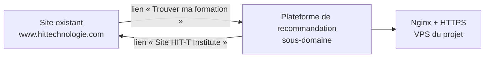

# Intégration à la plateforme existante de HIT-T

*Ajout v1.3 du cahier des charges (9 novembre 2026), à faire valider par le cabinet et les encadreurs.*

HIT-T Institute a déjà un site ([www.hittechnologie.com](https://www.hittechnologie.com)) et une boutique d'ebooks ([services.hittechnologie.com](https://services.hittechnologie.com)). La plateforme de recommandation doit s'y intégrer.

## Choix retenu : un sous-domaine relié au site

La plateforme reste une application à part, hébergée sur le VPS du projet, à une adresse du domaine de l'entreprise (par exemple `orientation.hittechnologie.com`, nom à choisir avec le cabinet). Le site existant y renvoie par des liens.

| Option | Retenue | Raison |
|---|---|---|
| Sous-domaine + liens depuis le site | **Oui (MVP)** | Marche quelle que soit la technologie du site existant, encore inconnue ; aucun risque pour le site en production ; rien à changer dans l'architecture |
| Page intégrée au site (iframe ou extension) | Non (V2) | Dépend de la technologie du site ; connexion Google et JWT plus délicats dans une iframe |
| Comptes partagés avec le site (connexion unique) | Non (V2) | Demande l'accès à la base ou à l'API du site existant |
| Catalogue lu dans la base du site | Non (V2) | Idem ; le MVP garde sa table `formations` (RF-04) |

## Ce que fait HIT-T (ou son prestataire web)

| Étape | Détail |
|---|---|
| 1. Choisir le sous-domaine | Ex. `orientation.hittechnologie.com` |
| 2. DNS | Ajouter un enregistrement `A` du sous-domaine vers l'adresse IP du VPS, chez le gestionnaire du domaine `hittechnologie.com` |
| 3. Liens sur le site | Menu : « Trouver ma formation » → `https://<sous-domaine>/` ; bouton sur l'accueil ou les pages formations : « Essayer sans compte » → `https://<sous-domaine>/essai` ; un lien par domaine si utile → `https://<sous-domaine>/formations?domaine=SISG` (ou `IA-Data`, `TRIT`, `TREB`) |

## Ce que fait le projet

| Élément | Réglage |
|---|---|
| `.env` du VPS | `DOMAINE=<sous-domaine>`, `CORS_ORIGINS=https://<sous-domaine>` |
| Certificat | Let's Encrypt pour le sous-domaine (`deploy/premier-certificat.sh`), une fois le DNS en place |
| Connexion Google | `https://<sous-domaine>` dans les origines JavaScript autorisées du client OAuth |
| Interface | Logo et coordonnées de HIT-T Institute, lien de retour vers le site dans le pied de page |
| Catalogue | Les 4 fiches du cabinet (96 formations), à tenir à jour par l'administrateur de la plateforme (RF-04) |

## Questions ouvertes pour le cabinet

1. Sur quelle technologie est construit le site existant, et qui peut y ajouter les liens ?
2. Quel nom de sous-domaine ?
3. Le catalogue du site et celui de la plateforme doivent rester identiques : qui met à jour la plateforme quand une fiche change ?
4. Faut-il, après la soutenance, aller plus loin (page intégrée, comptes partagés) ? Ce serait une V2.
