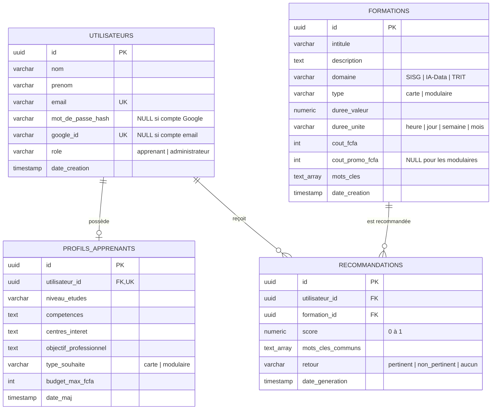

# Modèle de données

4 tables PostgreSQL. Scripts : [`database/01_schema.sql`](../database/01_schema.sql) puis [`database/02_catalogue_hitt.sql`](../database/02_catalogue_hitt.sql).

Pas de table d'historique de profilage : resoumettre le questionnaire **écrase** le profil et **remplace** les 5 recommandations de l'apprenant.



## Règles de gestion

| Règle | Mise en œuvre |
|---|---|
| Email unique | Contrainte `UNIQUE` sur `utilisateurs.email` |
| Un seul profil par apprenant | `profils_apprenants.utilisateur_id` `UNIQUE` |
| Le visiteur n'est pas stocké | Aucune ligne tant qu'il n'a pas créé de compte |
| Compte Google (RF-13) | `google_id` unique, `mot_de_passe_hash` NULL ; au moins l'un des deux est renseigné |
| Inscription publique = rôle `apprenant` | L'API force le rôle ; le compte admin est créé au démarrage (variables `ADMIN_*`) |
| Prix promo absent pour les modulaires | `cout_promo_fcfa` nullable |
| Durée hétérogène | `duree_valeur` + `duree_unite` |
| Suppression d'une formation | `ON DELETE CASCADE` sur les recommandations associées |
| Soumission ou resoumission du questionnaire | Création ou écrasement du profil (`INSERT … ON CONFLICT (utilisateur_id) DO UPDATE`) + suppression des anciennes recommandations + insertion des 5 nouvelles au plus (une transaction) |

## Écart par rapport au cahier des charges

La colonne `recommandations.mots_cles_communs` est ajoutée pour pouvoir réafficher les mots-clés explicatifs (RF-09) sur la page « Mes recommandations » sans relancer le calcul. Elle peut être retirée si l'on préfère recalculer à l'affichage.

## Chiffres clés (RF-11) en SQL

```sql
-- Nombre d'apprenants inscrits
SELECT count(*) FROM utilisateurs WHERE role = 'apprenant';

-- 5 formations les plus recommandées
SELECT f.intitule, f.domaine, count(*) AS nb
FROM recommandations r JOIN formations f ON f.id = r.formation_id
GROUP BY f.id ORDER BY nb DESC LIMIT 5;

-- Taux de retours « pertinent » (parmi les retours donnés)
SELECT round(avg((retour = 'pertinent')::int), 3) AS taux
FROM recommandations WHERE retour <> 'aucun';
```
