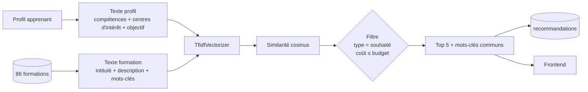

# Moteur de recommandation

Filtrage basé sur le contenu : **TF-IDF + similarité cosinus**, sans entraînement de modèle. Calcul refait à chaque soumission du questionnaire (`PUT /profil`).



## Étapes

1. **Texte formation** = intitulé + description + mots-clés.
2. **Texte profil** = compétences + centres d'intérêt + objectif professionnel.
3. **Vectorisation** avec `TfidfVectorizer` (ajusté sur les textes des formations, puis appliqué au profil).
4. **Similarité cosinus** entre le vecteur profil et chaque formation.
5. **Filtrage** : on écarte les formations d'un autre type que `type_souhaite` et celles dont le coût dépasse `budget_max_fcfa`, puis on garde les **5 meilleurs scores** et, pour chacune, les **mots-clés communs** au profil et à la formation.
6. **Persistance** : suppression des anciennes recommandations de l'apprenant, insertion des 5 nouvelles, réponse au frontend.

## Pseudo-code de référence

```python
from sklearn.feature_extraction.text import TfidfVectorizer
from sklearn.metrics.pairwise import cosine_similarity

def texte_formation(f):
    return " ".join([f.intitule, f.description, " ".join(f.mots_cles)])

def texte_profil(p):
    return " ".join([p.competences, p.centres_interet, p.objectif_professionnel])

def recommander(profil, formations, k=5):
    vectorizer = TfidfVectorizer(strip_accents="unicode", lowercase=True,
                                 stop_words=STOPWORDS_FR, ngram_range=(1, 1))
    X = vectorizer.fit_transform([texte_formation(f) for f in formations])
    q = vectorizer.transform([texte_profil(profil)])
    scores = cosine_similarity(q, X).ravel()

    candidats = [
        (f, s) for f, s in zip(formations, scores)
        if f.type == profil.type_souhaite
        and prix_effectif(f) <= profil.budget_max_fcfa
    ]
    candidats.sort(key=lambda c: c[1], reverse=True)

    texte_p = normaliser(texte_profil(profil))
    return [
        (f, float(s), [m for m in f.mots_cles if normaliser(m) in texte_p])
        for f, s in candidats[:k]
    ]
```

## Choix à trancher pendant le développement

| Point | Proposition par défaut |
|---|---|
| Prix comparé au budget | Prix promo s'il existe, sinon prix normal (`prix_effectif`) |
| Stop-words français | Liste fixe dans le code (scikit-learn n'en fournit pas en français), plus les verbes génériques des projets (« devenir », « apprendre »…) depuis le 29/10/2026 |
| Découpage | Mots seuls (`ngram_range=(1, 1)`) depuis le 29/10/2026 ; les paires de mots n'amélioraient pas la mesure ([journal des essais](evaluation.md)) |
| Accents / casse | `strip_accents="unicode"`, `lowercase=True` |
| Score nul | Les formations de score 0 ne sont pas recommandées |
| Doublon « Initiation Informatique » (SISG et TRIT) | Ne garder qu'une occurrence par intitulé dans le top 5 |
| `niveau_etudes` | Collecté mais non utilisé pour le score (même niveau d'admission partout) |

## Implémentation

`backend/app/services/recommandation.py`, fonction pure sans base :

```python
recommander(profil, formations, k=5) -> list[Resultat]  # Resultat(formation, score, mots_cles_communs)
```

- `profil` : tout objet avec `competences`, `centres_interet`, `objectif_professionnel` (vides ou `None` acceptés), `type_souhaite` et `budget_max_fcfa`.
- `formations` : les formations ORM lues en base (ou tout objet avec les mêmes attributs).
- Les choix par défaut du tableau ci-dessus sont appliqués. Un mot-clé est « commun » s'il apparaît en mots entiers dans le texte du profil, sans tenir compte des accents ni de la casse.
- À score égal, l'ordre de la liste `formations` est conservé ; un intitulé en double garde son meilleur score.

## Aperçu pour les visiteurs (RF-12)

Même fonction `recommander`, appelée avec :

- un texte de profil réduit à la seule réponse « ce que vous aimeriez apprendre » ;
- `k = 3` ;
- aucune persistance (pas d'écriture dans `recommandations`).

Le texte étant plus court, les scores sont en général plus faibles qu'avec le questionnaire complet : l'écran l'indique (« le questionnaire complet affine ce résultat »).

## Performance

86 formations : vectorisation + calcul < 1 s (exigence : affichage < 3 s). La matrice TF-IDF des formations peut être mise en cache et invalidée à chaque modification du catalogue (RF-04).

Voir aussi le [protocole d'évaluation](evaluation.md).
