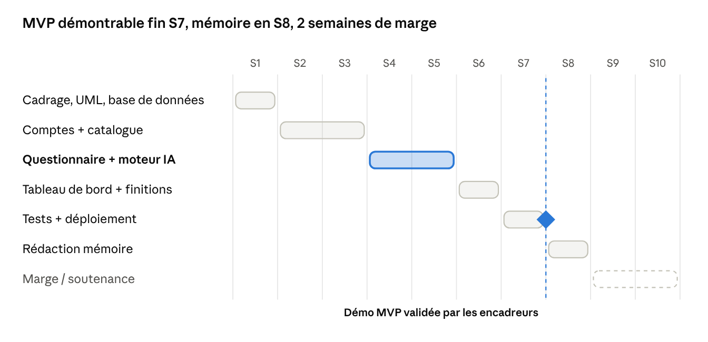

# Planning et backlog

Méthode : **Scrum allégé**, sprints d'une semaine, démo aux encadreurs en fin de **S3, S5 et S7** (dates à fixer dès la S1).

| Semaine | Thème | Tâches principales | Fin de sprint |
|---|---|---|---|
| S1 | Cadrage, UML, base de données | Dépôt GitHub, diagrammes UML, schéma SQL, chargement du catalogue, Docker Compose (db), squelettes backend/frontend, fixer les dates de démo | Base avec 86 formations ✓ |
| S2 | Comptes + catalogue | Modèles ORM, `/auth/register`, `/auth/login`, `/users/me`, bcrypt + JWT ; `GET /formations` ; **validation des descriptions et mots-clés par le cabinet** | API comptes OK |
| S3 | Comptes + catalogue | CRUD admin formations, `/auth/google` (RF-13), pages Connexion/Inscription (avec Google) et Catalogue (filtres, détail), routes protégées | **Démo 1** |
| S4 | Questionnaire + moteur IA | `PUT /profil`, page Questionnaire, moteur TF-IDF + cosinus, rédaction des 20 profils de test | Top 5 renvoyé par l'API |
| S5 | Questionnaire + moteur IA | Page Mes recommandations (mots-clés, retour), `POST /recommandations/{id}/retour`, aperçu visiteur `POST /recommandations/apercu` + page `/essai` + exemple sur l'accueil (RF-12), première mesure précision@5, ajustements | **Démo 2** |
| S6 | Tableau de bord + finitions | `GET /admin/statistiques`, page Administration, responsive mobile, messages d'erreur | Parcours complet |
| S7 | Tests + déploiement | Tests API, VPS, Nginx, HTTPS, comptes de démo, panel d'apprenants | **Démo MVP validée** |
| S8 | Rédaction mémoire | Évaluation (précision@5, retours panel), rédaction | Mémoire |
| S9–S10 | Marge / soutenance | Corrections, répétition | Soutenance |

## Répartition entre les deux développeurs

Deux développeurs, chacun responsable de **fonctionnalités complètes** : API, page, tests et mise à jour de la doc. Les deux travaillent en parallèle sans s'attendre, et chacun présente ses fonctionnalités aux démos.

- **Dev 1** — BenKL404 : comptes et sécurité, administration, aperçu visiteur, déploiement.
- **Dev 2** — nouveau membre (compte GitHub à ajouter) : catalogue public, questionnaire, moteur de recommandation et son évaluation.

Dev 2 commence par le catalogue public, simple et sans authentification, pour prendre en main le dépôt pendant que Dev 1 pose les fondations des comptes.

### Par sprint

| Sprint | Dev 1 — BenKL404 | Dev 2 |
|---|---|---|
| S2 | Modèle `Utilisateur` ; `services/security.py` (bcrypt, JWT, `get_current_user`, `require_admin`) ; `/auth/register`, `/auth/login`, `/users/me` ; compte admin créé au démarrage (RF-01 à RF-03) | Modèle `Formation` ; `GET /formations` (filtres `domaine`, `type`) et `GET /formations/{id}` (RF-05) ; prise en main du dépôt et des agents Claude |
| S3 | `POST/PUT/DELETE /formations` réservés à l'admin (RF-04) ; `/auth/google` (RF-13) ; pages Connexion et Inscription avec le bouton Google | Pages Catalogue (liste, onglets domaine, filtre type) et Détail d'une formation (RF-05), desktop et mobile |
| S4 | Page Accueil (écran 09, sans l'exemple RF-12) : sa route est à choisir avec Dev 2, car `/` affiche aujourd'hui le catalogue ; menu mobile et en-tête selon le rôle (M6) | Modèles `ProfilApprenant` et `Recommandation` ; `PUT /profil` (RF-06, RF-07) ; moteur `services/recommandation.py` (RF-08, RF-09) ; page Questionnaire ; squelette des 20 profils de test |
| S5 | Aperçu visiteur (RF-12) : `POST /recommandations/apercu` avec limite par IP, page `/essai`, exemple sur l'accueil, pré-remplissage du questionnaire après inscription | Page Mes recommandations (libellé de correspondance, mots-clés) ; `POST /recommandations/{id}/retour` (RF-10) ; script précision@5 et première mesure |
| S6 | `GET /admin/statistiques` (RF-11) ; page Administration (chiffres clés + gestion du catalogue, écrans 07, 08, 16, 17) | Ajustements du moteur (journal des essais) ; écrans d'état : aucune recommandation, erreurs du questionnaire, page introuvable (12, 13, 18) ; responsive mobile de ses pages |
| S7 | Déploiement : VPS, nginx, HTTPS, comptes de démo ; vérification avant démo | Tests API complémentaires sur tout le parcours ; organisation du panel d'apprenants (≥ 5 testeurs) |
| S8 | Mémoire : architecture, sécurité, déploiement | Mémoire : moteur, évaluation (précision@5, retours du panel) |

Tâches hors développement, à confier à quelqu'un qui est en contact avec le cabinet : validation des descriptions et mots-clés du catalogue (S2) ; annotation des 20 profils de test par un conseiller (S4–S5) ; dates des démos.

### Points de contact entre les deux

| Quand | Ce qui est partagé | Règle |
|---|---|---|
| S2 | `backend/app/models/` | Un fichier par modèle : Dev 1 écrit `utilisateur.py`, Dev 2 écrit `formation.py`, puis `profil.py` et `recommandation.py`. Chacun ajoute son import dans `models/__init__.py`. |
| S2 → S4 | `require_admin`, `get_current_user` (Dev 1) | Utilisés par Dev 2 pour `PUT /profil` et le retour : ils doivent être sur `main` avant la S4. |
| S4 → S5 | `recommander(profil, formations, k)` (Dev 2) | Fonction pure, sans base, avec la signature de `docs/moteur-recommandation.md` : Dev 1 l'appelle avec `k = 3` pour l'aperçu. |
| Toujours | `app/main.py` (routers), `src/App.tsx` (routes), `src/api/types.ts`, `docs/api.md` | Chacun ajoute ses lignes sans réorganiser celles de l'autre ; contrat de référence : `docs/api.md`. |

### Façon de travailler

- Une issue par tâche, assignée à son responsable, avec son `RF-xx` et son jalon (`S2` … `S8`) ; une branche et une PR par issue (`CONTRIBUTING.md`).
- Chaque PR est relue par l'autre développeur avant la fusion ; l'agent Claude `relecteur-pr-mvp` fait une première passe.
- Un point rapide en début de sprint pour vérifier les points de contact du tableau ci-dessus.

## Suivi

Chaque tâche est une *issue* GitHub reliée à une exigence (`RF-xx`) et à un jalon (`S1` … `S8`). Suggestion de labels : `comptes`, `catalogue`, `profilage`, `recommandation`, `admin`, `infra`, `doc`, `bug`, `V2`.

Tout ce qui sort du périmètre MVP reçoit le label `V2` et n'est pas traité avant la soutenance.
