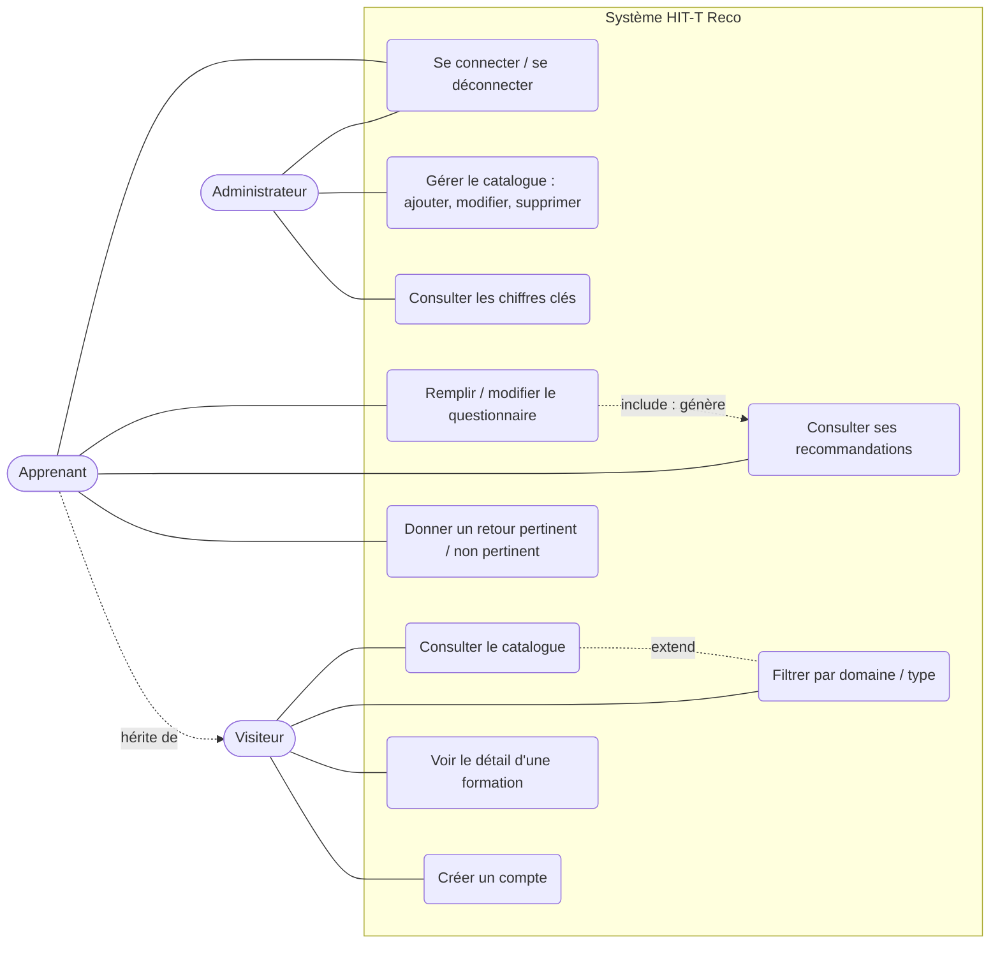
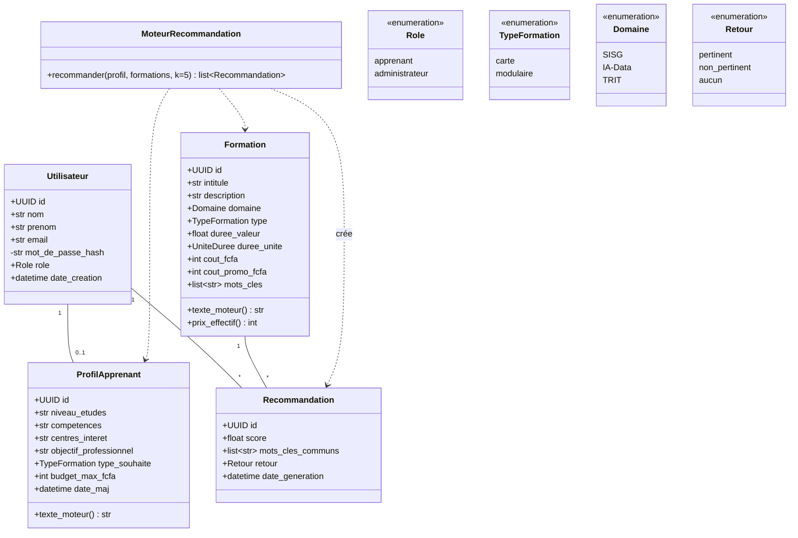
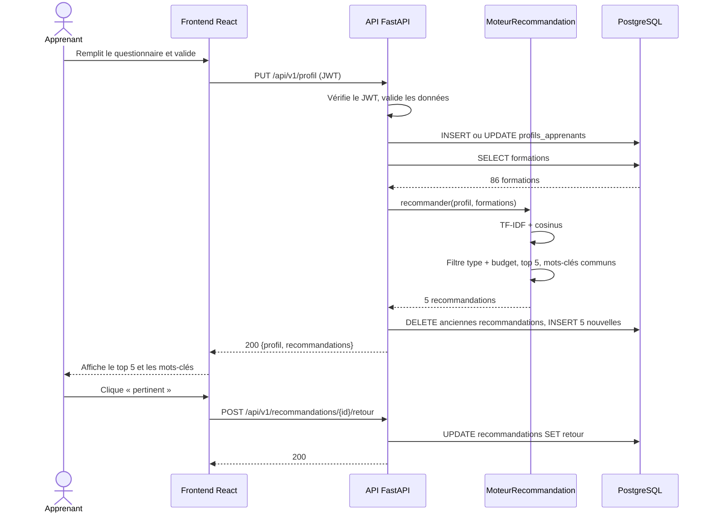

# Diagrammes UML

Livrable « Diagrammes UML » du cahier des charges : cas d'utilisation, classes, séquence « obtenir des recommandations ». Les diagrammes sont en [Mermaid](https://mermaid.js.org/) et s'affichent directement sur GitHub.

## 1. Cas d'utilisation

L'apprenant hérite des cas du visiteur. Le rôle Conseiller pédagogique est reporté en V2.

## 2. Classes

## 3. Séquence « obtenir des recommandations »

